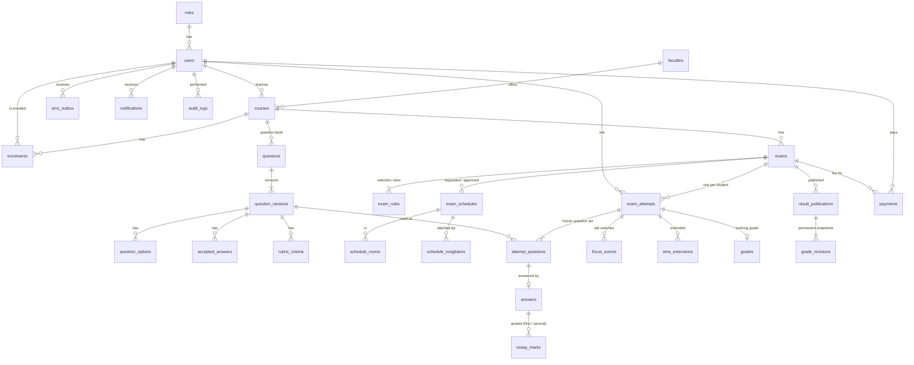

# Online Exam Platform (Project 18)

An online examination platform that Somali universities can run on their own campus network.

Paper exams take long to mark, students can copy from their neighbours, and lecturers get little information about how good their questions are. This platform tackles each problem:
- every student gets their own randomized exam of equal difficulty;
- the server enforces the time limit;
- the system grades automatically where it can;
- invigilators can watch the session live;
- lecturers get question analytics.

> **Status:** the database and the **backend API are complete and tested**. The **frontend foundation** (design system, app shell for the four roles, light and dark mode, Somali/English, profile page and chart components) is in place, and the **registrar (admin) dashboard** is built on the live API: overview, users, faculties, courses, enrolment with CSV import, examination oversight, and reports. The **lecturer dashboard** is built too: question bank with CSV import, exam builder, schedule requests, grading (including blind second grading), results publication and analytics. The **student dashboard** is built: courses, examinations with countdowns, the **exam screen** (server-synced timer, autosave with recovery, tab-switch reporting, submission), published results with the result slip, and exam-fee payments (simulated). The **invigilator dashboard** is built: assigned sessions, a live monitoring table (not started / in progress / disconnected / submitted), tab-switch log, individual time extensions and session notes. **Sign-in and account** are complete: every page needs a signed-in session (visitors are sent to `/sign-in` and return to the page they asked for), temporary passwords must be changed first, and the profile page changes the password.


---

## Features

| Area | Brief | Status |
|---|---|---|
| Four roles with server-side permission checks on every request | 2, 6.2 | ✅ Done (API) |
| Faculties, courses, enrolment, CSV student import, dropping without losing results | 4.1 | ✅ Done (API) |
| Question bank (MCQ, True/False, short answer, essay), images, versions for used questions | 4.2 | ✅ Done (API) |
| CSV question import with preview, error reasons and duplicate skipping | 4.3 | ✅ Done (API) |
| Exam builder with difficulty rules, enough-questions check and a sample preview | 4.4 | ✅ Done (API) |
| Scheduling: request and approval; conflicts blocked for students, rooms and invigilators | 4.5 | ✅ Done (API) |
| **Fair randomized exams**: different sets, equal difficulty and marks | 3 | ✅ Done, tested |
| **Server-side deadline**: late answers rejected, automatic submission | 3, 4.7 | ✅ Done, tested |
| **Recovery**: same questions, saved answers and remaining time after a reload | 3, 4.7 | ✅ Done, tested |
| Tab-switch logging (only losses of 1 second or more count; warning after 3) | 4.8 | ✅ Done (API). The browser detection is part of the frontend. |
| Invigilator live view, disconnected after 30 s, notes, extensions of up to 15 min | 4.9 | ✅ Done (API) |
| Automatic grading; unmatched short answers marked "Needs review" | 4.10 | ✅ Done |
| Essay grading with a rubric; optional blind second grader | 4.11 | ✅ Done (API) |
| Results with full publication history, change notifications, answer review | 4.12 | ✅ Done (API) |
| Difficulty index, discrimination, statistics, CSV grade export | 4.13 | ✅ Done (API) |
| Dashboard charts from real queries | 6.7 | 🟡 Partial: data endpoints done; the charts are drawn by the frontend |
| Somali and English | 6.8 | 🟡 Partial: SMS, notifications, PDFs and CSV headers are translated by the server; the screens are frontend work |
| Simulated EVC Plus, Zaad and eDahab payments, with a receipt | 7 | ✅ Done (API) |
| Simulated SMS outbox | 7 | ✅ Done |
| Audit log of sensitive actions | 6.2 | ✅ Done |
| Automated tests (one command) and CI | 6.4 | ✅ Done: 257 tests, GitHub Actions |
| Screens (Next.js, mobile layout, language switch) | 6.1, 6.8 | ⏳ Next stage |

## Architecture

```
 Browser (Next.js, next stage)
        │  HTTPS / JSON, HTTP-only session cookie
        ▼
 Express API  backend/src
   routes        modules/*/*.routes.ts     validation (zod), role checks, HTTP shape
   services      modules/*/*.service.ts,   business rules, ownership checks, transactions
                 services/*.ts
   repositories  repositories/*.ts         the only code that queries the database (Prisma)
   adapters      adapters/mobile-money.ts, simulated payment and SMS providers
                 adapters/sms-gateway.ts
   db            db/prisma.ts, db/clock.ts Prisma Client, transactions, clock sync, health check
   jobs        jobs/scheduler.ts         auto-submit at the deadline, payment expiry, SMS status
        │  restricted role exam_app (no owner rights), TLS for Supabase
        ▼
 PostgreSQL 17: campus server (primary) or Supabase (hosted copy)
   35 tables, CHECK constraints, triggers and row-level security as a second line of defence
```

**Layers**
- Screens never touch the database. Routes call services, and services call repositories. Only `src/repositories` and `src/db` use Prisma.
- A service decides where a transaction starts and passes the transaction handle on to the repositories. That way, multi-step changes succeed or fail together.
- `tests/unit/architecture.test.ts` fails if any other file uses Prisma.
- Important rules are enforced twice: by the service and by the database. For example:
  - the answer deadline is also checked by a trigger;
  - used question versions are locked by a trigger;
  - payment status changes are checked by a trigger;
  - result history is append-only.

**Main modules**

| Module | Path |
|---|---|
| auth | `src/modules/auth` |
| users | `src/modules/users` |
| courses | `src/modules/courses` |
| imports | `src/modules/imports` |
| questions | `src/modules/questions` |
| exams and schedules | `src/modules/exams`, `src/modules/schedules` |
| attempts | `src/modules/attempts` |
| invigilation | `src/modules/invigilation` |
| grading | `src/modules/grading` |
| results | `src/modules/results` |
| payments | `src/modules/payments` |
| messages | `src/modules/messages` |
| analytics | `src/modules/analytics` |
| rooms | `src/modules/rooms` |
| grading scale | `src/modules/grading-scale` |

**Core technical challenge**

| Condition | How it is met | Code |
|---|---|---|
| Different sets, equal difficulty | Each rule fixes the type, difficulty and marks. The least-used questions are drawn first, and the order and options are shuffled per student. | `src/services/exam-generator.ts` |
| Late answers rejected | The deadline is set once on the server: min(start + duration, window end) + extensions. Saves are checked by the service and by a database trigger that uses the database clock. | `src/modules/attempts`, `src/services/submission.ts` |
| Resume after a reload | One attempt per student and exam. Reloading returns the frozen question set, the saved answers and the remaining time from the server deadline. | `src/modules/attempts` |

## Technology

| Part | Technology |
|---|---|
| Runtime | Node.js 24 (20 or newer works) |
| API | Express 5.3.0, TypeScript 5.9.3, Zod 4.6.7 |
| Database | PostgreSQL 17 (15+), Prisma ORM 7.10.1 with `@prisma/adapter-pg` |
| Security | bcryptjs 3.0.3 (cost 12), jsonwebtoken 9.0.3 (HTTP-only cookie), helmet 8.3.0, express-rate-limit 8.7.3 |
| Files | csv-parse 7.0.3 (imports), PDFKit 0.20.2 (receipts, result slips), multer 2.5.0 (uploads) |
| Tests | Vitest 4.1.12, supertest 7.3.1, embedded-postgres 17 (throwaway test database) |
| Frontend | Next.js 16.4.5 (App Router), React 19.3, TypeScript, Tailwind CSS 4.3, Radix UI, Recharts 3.10, Lucide icons |

## Install on a fresh computer

You need **Node.js 20 or newer** and **Git**. Docker and a PostgreSQL installation are not needed to run the tests.

```bash
git clone https://github.com/Nafiisamohamed/online-exam-platform.git
cd online-exam-platform/backend
npm install            # also generates the Prisma Client
npm test               # 257 tests on a throwaway PostgreSQL 17, started automatically
```

## Database setup

1. Copy `backend/.env.example` to `backend/.env`. Never commit `.env`.
2. Point `MIGRATE_DATABASE_URL` at the database owner. Use one of:
   - a campus or local PostgreSQL 17;
   - the Supabase Session Pooler. `npm run db:supabase-login` asks for the password and encodes it for you.
3. Run, from `backend/`:

```bash
npm run db:migrate        # prisma migrate deploy: applies the 3 migrations
npm run db:app-password   # enables the restricted exam_app login and writes DATABASE_URL
npm run db:seed:demo      # optional demo data: Somali names, real cities, USD fees
npm run db:seed:demo:analytics  # optional: 30 more students and a 38-student exam for analytics (loaded on Supabase)
npm run db:check          # read-only health check: every line must say PASS
```

Then set the API settings in `.env`:
- `JWT_SECRET` (at least 32 random characters);
- `DEMO_PAYMENT_PIN`;
- `CORS_ORIGIN`.

`.env.example` lists every setting with placeholders only.

More on the database:
- [docs/database.md](docs/database.md): the tables, rules, triggers and access security.
- [docs/database-environments.md](docs/database-environments.md): campus PostgreSQL vs Supabase, credentials, backups.

### Database diagram (main relationships)



The full list of 35 tables is in [docs/database.md](docs/database.md#tables-35).

## Run the API

```bash
cd backend
npm run dev                  # development: reloads on change, http://localhost:4000/api
npm run build && npm start   # production build
```

**Check it's running:** `GET http://localhost:4000/api/health` answers `{ "status": "ok", "database": "ok", "serverTime": "…" }`.

**Background jobs:** the server runs them every 5 seconds:
- automatic submission at the deadline;
- payment expiry;
- SMS status updates.

## Run the frontend

```bash
cd frontend
npm install
npm run dev                  # http://localhost:3000
npm run build && npm start   # production build
```

- The browser talks only to the Next.js server. Requests to `/api/*` are forwarded to the API at `BACKEND_URL` (default `http://localhost:4000`), so the session cookie stays on one origin.
- **If port 4000 is already used by another program**, run the API on another port for that session and point the frontend at it, without editing either config file:
  ```bash
  cd backend  && PORT=4100 npm run dev
  cd frontend && BACKEND_URL=http://localhost:4100 npm run dev   # or: npm run build && npm start
  ```
  For `npm run build`, `BACKEND_URL` must be set when building: Next.js fixes the forwarding address at build time. Check with `curl http://localhost:3000/api/health`; it should return `{"status":"ok","database":"ok",…}`.
- Sign in at `/sign-in` (student number or staff email). Accounts with a temporary password must choose a new one before anything else opens. Signing out ends the browser session; a session that the server ends (deactivated account, changed password) returns the user to the sign-in page with a message: at the next request, at the latest within 30 seconds on an idle page, and at once when the user comes back to the tab. The profile page changes the password (current, new, repeat; the server's rule: 8+ characters with a letter and a digit) and the language used for SMS and notifications.
- The registrar pages are under `/admin/*`, the lecturer pages under `/lecturer/*` the student pages under `/student/*` and the invigilator pages under `/invigilator/*`; each role's overview is at `/dashboard`. A running exam opens at `/exam/<attemptId>`, outside the menus. They show live API data only. When nobody is signed in they ask the user to sign in, and they never show sample numbers.
- **The exam screen follows the server.** The timer counts down from the server's remaining time (re-synced by a heartbeat every 5 seconds, so invigilator extensions appear at once; changing the device clock has no effect). Each answer shows "Saved" only after the server accepted it; failed saves are retried and the page warns before leaving with unsaved answers. A refresh returns the same attempt with the saved answers. Leaving the page is reported to the server, which counts losses of 1 second or more and warns after 3, with no automatic penalty.
- Lecturers build exams from **question rules** (N questions of a type, difficulty and mark value, optionally from topics). Each student gets their own random draw, as the backend's exam generator works; questions are not hand-picked. A schedule request goes to the registrar for approval.
- Without a session no page opens: every route redirects to `/sign-in` (there is no preview mode and no sample data).
- Frontend checks: `npm run lint`, `npm run typecheck`, `npm test`.

## Tests

```bash
cd backend
npm test            # everything: 150 database + 80 API + 27 unit tests
npm run test:api    # API only
npm run test:unit   # pure logic only
npm run verify:db   # non-destructive checks against an existing database, e.g. Supabase
```

- **Where the tests run:** against a fresh, throwaway PostgreSQL 17 (or your own test database), never against Supabase or development data.
- **Coverage:** the three completion conditions, permissions, payments, grading, publication history and more.
- **CI:** [`.github/workflows/ci.yml`](.github/workflows/ci.yml) runs the type check, the tests and the build on every push, for the backend and for the frontend (which also runs lint).
- **Details:** [docs/testing.md](docs/testing.md).

## API reference

Every endpoint, with method, path, roles, request, response and error codes: **[docs/api.md](docs/api.md)**.

## Demo accounts

`npm run db:seed:demo` creates fictional accounts for every role (Somali names, `.test` email addresses that can never receive mail):

| Role | Login |
|---|---|
| Admin / Registrar | `registrar@uni-demo.test` |
| Lecturer | `axmed.samatar@uni-demo.test`, `mustafe.jibriil@uni-demo.test`, `khadra.cilmi@uni-demo.test` |
| Invigilator | `cabdiraxmaan.faarax@uni-demo.test`, `deeqa.aadan@uni-demo.test` |
| Student | `DEMO-2026-0001` … `DEMO-2026-0010` |

**Passwords**
- Each account gets a random password, stored only as a bcrypt hash.
- The plain passwords are written once, to `backend/demo-accounts.local.md` on the machine that ran the seed. Git ignores that file.
- They are not published here, because the hosted demo database is reachable from the internet.
- Judges receive them privately. On demo day, `npm run demo:judge-credentials` issues fresh passwords for one account per role (plus a second lecturer and a second student) and writes them to a private, git-ignored sheet. Running it again after judging changes them, so the judges' passwords stop working. See [docs/demo-data.md](docs/demo-data.md#giving-the-judges-access).

**Simulated payments:** the demo PIN is the `DEMO_PAYMENT_PIN` setting (`1234` in `.env.example`). It is not a real PIN.

See [docs/demo-data.md](docs/demo-data.md) for the full dataset.

## Security

| Area | How it is handled |
|---|---|
| Passwords | bcrypt (cost 12). Temporary passwords must be changed at first login and expire after 7 days. |
| Sessions | JWT in an HTTP-only, SameSite=Strict cookie. A password change or deactivation ends all sessions. Signing out clears the cookie in the browser; the signed token itself is stateless, so a copy of it would stay valid until it expires (see the limitations below). |
| Permissions | The role and record ownership are checked on the server for every request. Other people's records return 404. |
| Input | Validated with zod. Uploads are size-limited and type-checked. CSV exports are protected against spreadsheet formulas. |
| Rate limits | On the API, the login and the demo PIN |
| Audit log | Sensitive actions are logged (append-only). Secrets are removed from log details. |
| Database role | The API connects as `exam_app`: not the owner, no RLS bypass, can't disable triggers or alter tables |
| Simulated services | Payments and SMS can only run simulated: the server refuses to start otherwise |
| Secrets | `.env` is ignored by git. `.env.example` contains placeholders only. |

## Known limitations

| Limitation | Notes |
|---|---|
| Frontend modules not built | Every menu entry opens a finished page. The registrar has no separate screens for exam rooms, a schedule list, payments, the SMS outbox or the audit log (the API supports them; schedule approval is done from the examination detail page). |
| Dev-mode console message | In `npm run dev` only, Next.js reports "Could not validate that a segment in your UI has instant navigation" for pages under the role layouts (/admin, /lecturer, /student, /invigilator). Those pages wait for the signed-in user before rendering, so they cannot be pre-rendered for that check. Production builds do not run it and show no console errors. |
| Sign-out does not revoke the token | `POST /api/auth/logout` only clears the cookie. The session token is stateless (8 hours), so a copy of it taken before sign-out keeps working until it expires, or until the password is changed or the account is deactivated. Revoking it on logout would need a backend change (bumping the user's token version), which also ends the same user's other devices, so it was left for the owner to decide. |
| Invigilator dashboard limits (from the API) | Invigilators see only status: no questions, answers or marks. The backend does not give them the exam’s instructions or the enrolled count outside the live list, and has no separate “incident” record, so observations are the session notes (author and time recorded by the server). The live list is polled every 5 seconds; there is no push channel. |
| Profile limits (from the API) | A profile cannot be edited except for the language used for SMS and notifications (PATCH /api/auth/language) and the password; there is no photo upload. The faculty shown for a student is the faculty of their enrolled courses (the profile endpoint has no faculty field). |
| Lecturer dashboard limits (from the API) | Lecturers see enrolled students per course (read-only) and per-exam results; there is no per-student profile endpoint for them. The audit log is registrar-only, so the lecturer overview shows the lecturer's own notifications as recent activity. |
| Registrar dashboard limits (from the API) | The backend has no faculty delete or deactivate, no course status, and no list of all enrolments (they are listed per course). Reports have no date filter, and PDF export exists only for students. The screens say so instead of offering these. |
| Somali texts | The Somali translations in `frontend/src/lib/i18n/messages/so.ts` should be reviewed by a native speaker. |
| Campus network rule | It relies on the client IP address. Behind a reverse proxy, set `TRUST_PROXY=true`. |
| Clock offset | The browser shows the time remaining from the server's timer. Network delay of a few hundred milliseconds isn't compensated, so the last-chance warnings appear slightly early. |
| Short-answer matching | It ignores only case and extra spaces, as the brief says. Punctuation differences go to "Needs review". |
| Backup and restore | The exact procedure is in [docs/backup-restore.md](docs/backup-restore.md). It has not been rehearsed yet: the development machine has no PostgreSQL client tools, and Docker and a local installation are excluded. Rehearse it on the campus server. |
| Not built | Real payment and SMS gateways, webcam proctoring and plagiarism checking are out of scope, as the brief says. |
