# Online Exam Platform (Project 18)

An online examination platform that Somali universities can run on their own campus network.

Paper exams take long to mark, students can copy from their neighbours, and lecturers get little information about how good their questions are. This platform tackles each problem:
- every student gets their own randomized exam of equal difficulty;
- the server enforces the time limit;
- the system grades automatically where it can;
- invigilators can watch the session live;
- lecturers get question analytics.

> **Status:** complete and running. One application, one codebase, one database: the backend API, the database (PostgreSQL 17 on Supabase, 9 migrations, 42 tables) and the screens for all four roles (registrar, lecturer, student, invigilator) in Somali and English, with light and dark mode. Payments and SMS are **simulated**: no money moves and no real text message is sent. A step-by-step guide for trying everything by hand is in [docs/manual-testing.md](docs/manual-testing.md).


---

## Features

| Area | Brief | Status |
|---|---|---|
| Four roles (registrar, lecturer, student, invigilator) with server-side permission checks on every request; automatic account numbers (`S-`, `T-`, `R-`, `I-YYYY-NNN`); sign-in by username; server-side sign-out | 2, 6.2 | ✅ Done |
| Academic years, Semesters 1–8, faculties with assigned lecturers, courses per year and semester, student registration and enrolling a whole semester group; CSV student import | 4.1 | ✅ Done |
| Question bank (MCQ, True/False, short answer, essay), images, versions for used questions; **question review** (only reviewed questions go into newly published exams) | 4.2 | ✅ Done |
| CSV question import with preview, error reasons and duplicate skipping | 4.3 | ✅ Done |
| Exam builder: **exam type** (Quiz, Midterm, Final), question rules by type, difficulty and marks, enough-questions check, unticking individual questions, sample preview | 4.4 | ✅ Done |
| Scheduling: lecturer request, registrar approval; duration worked out from the window; **rooms with capacity** (summed; unknown capacity needs confirmation; too small blocks approval); conflicts blocked | 4.5 | ✅ Done |
| **Fair randomized exams**: different sets, equal difficulty and marks | 3 | ✅ Done, tested |
| **Server-side deadline**: late answers rejected, automatic submission | 3, 4.7 | ✅ Done, tested |
| **Recovery**: same questions, saved answers and remaining time after a reload | 3, 4.7 | ✅ Done, tested |
| Tab-switch logging (only losses of 1 second or more count); **the 3rd counted switch terminates the attempt** (saved answers kept and sent to the lecturer) | 4.8 | ✅ Done. Project policy, stricter than the brief. |
| Invigilator live view, disconnected after 30 s, notes, extensions of up to 15 min | 4.9 | ✅ Done |
| Automatic grading; unmatched short answers marked "Needs review"; essay rubric; optional blind second grader | 4.10, 4.11 | ✅ Done |
| **Grading** (marking) and **Results** (publish, revise with a reason, publication history, CSV export) as separate lecturer pages; registrar **read-only results search** | 4.12 | ✅ Done |
| Difficulty index, discrimination, statistics, dashboard charts from real queries | 4.13, 6.7 | ✅ Done |
| **Semester fees** per faculty, year and semester; partial payments with simulated EVC Plus, Zaad and eDahab; receipts; **exam eligibility** (Quiz 30 %, Midterm 50 %, Final 100 % of the fee paid); registrar paid / partly paid / unpaid lists and reminders | 7 | ✅ Done (simulated) |
| **SMS Management**: Somali and English templates, group messages by role, faculty, year, semester or course, outbox with statuses and retry; in-app notifications | 7 | ✅ Done (simulated) |
| **Activity History**: who did what and when, with filters and a Somali or English CSV export | 6.2 | ✅ Done |
| Manual testing guide with five demo scenarios: [docs/manual-testing.md](docs/manual-testing.md) | – | ✅ Done |
| Somali and English everywhere (screens, SMS, notifications, PDFs, CSV headers) | 6.8 | ✅ Done |
| Automated tests (one command) and CI | 6.4 | ✅ Done: 301 backend + 46 frontend tests, GitHub Actions |

## Screenshots

Taken from the running application (English, light mode) with the fictional demo data. Every screen is also available in Somali and in dark mode.

### Registrar

**Dashboard:** accounts, courses and examinations at a glance, with charts from live data.

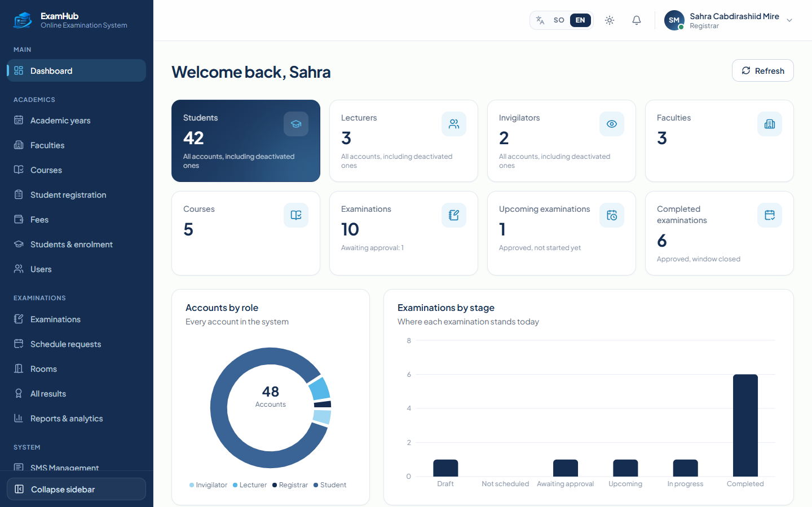

**Payment management:** the fee of each faculty and semester, and who has paid in full, in part or not at all, with payment reminders.

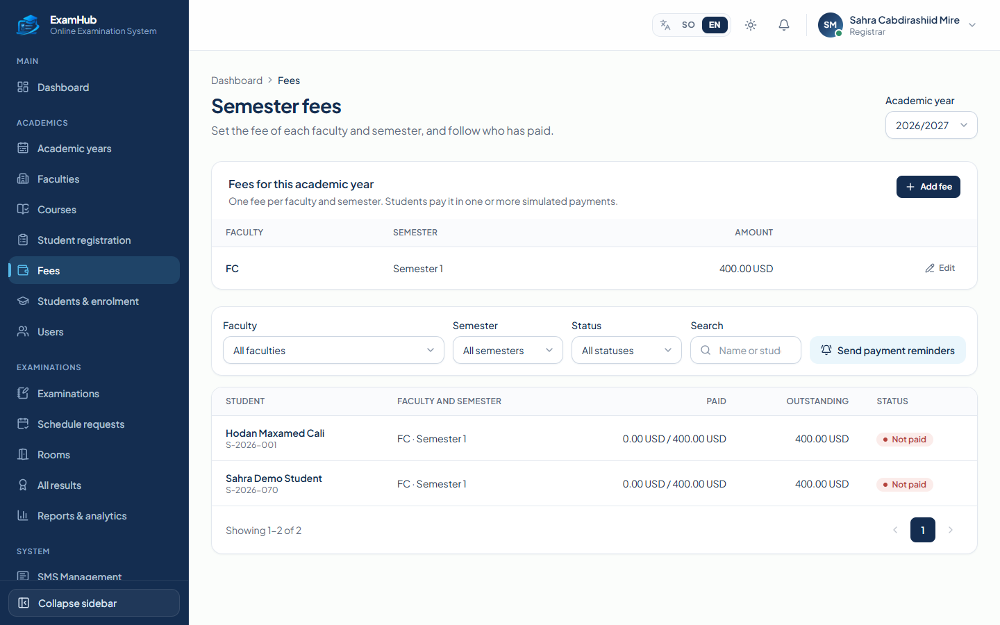

**Results (read only):** search every student's results by faculty, year, semester, course, exam type and publication status.

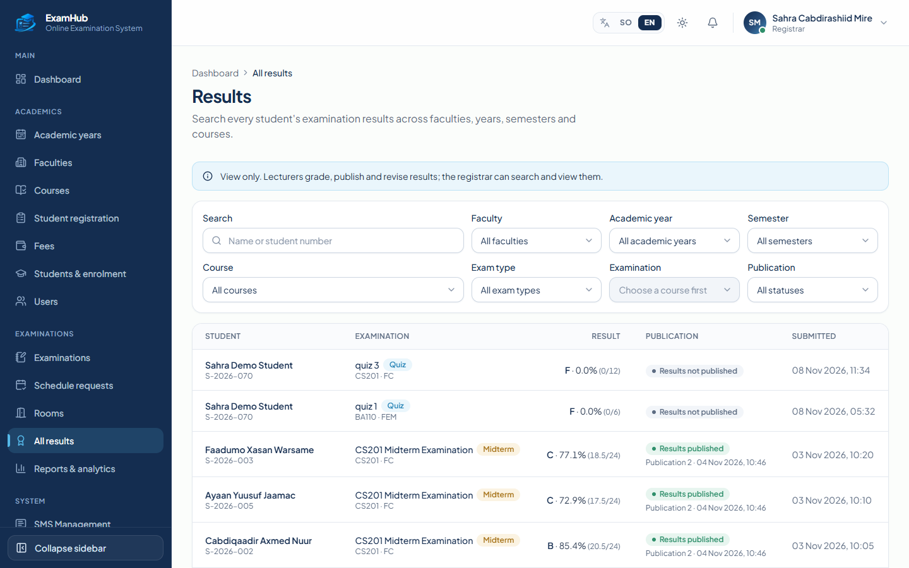

### Lecturer

**Dashboard:** courses, examinations, grading still to do and average scores.

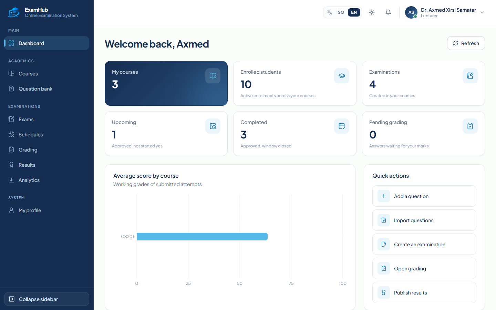

**Question bank:** questions per course with type, difficulty, marks, review status and versions; CSV import in the second tab.

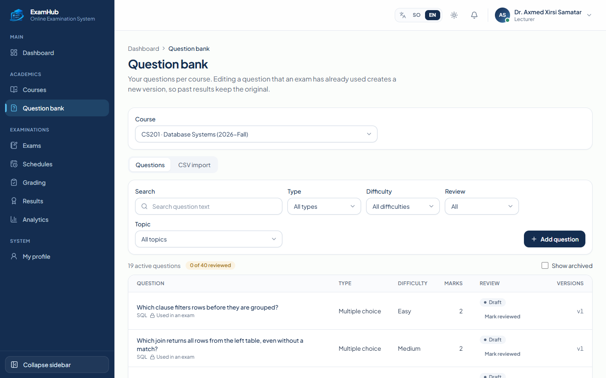

**Exam management:** exam type, workflow from publishing to registrar approval, settings and the schedule with rooms and invigilators.

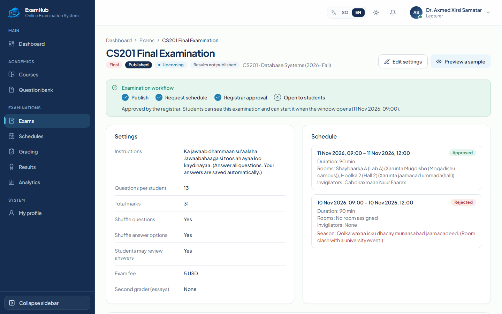

**Grading:** examinations with answers that still need marks; multiple choice and matching short answers are graded automatically.

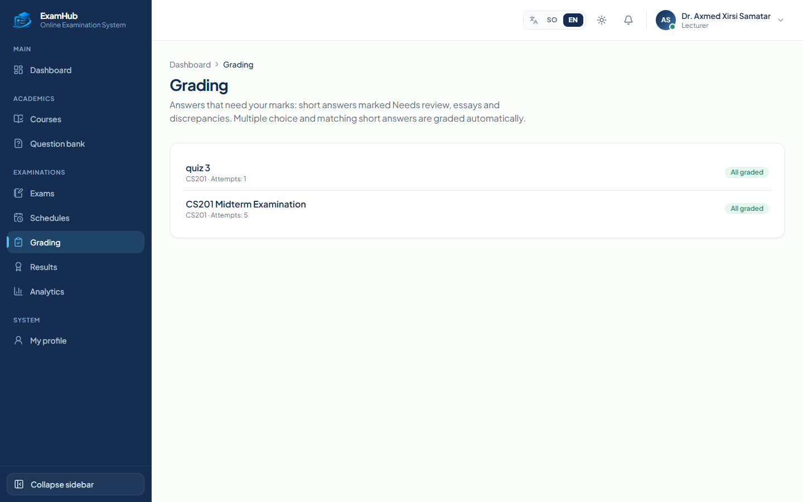

**Results:** publish, reopen with a reason, publication history, every student's grade and the CSV export.

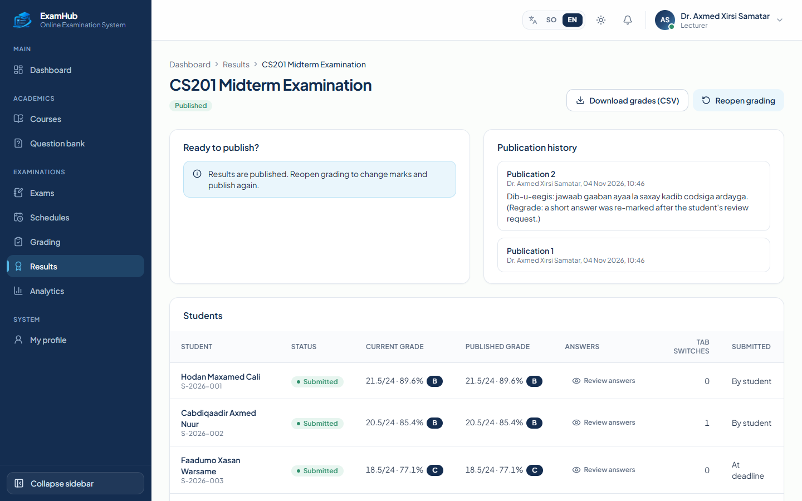

### Student

**Dashboard:** examinations that are open now, upcoming ones and published results.

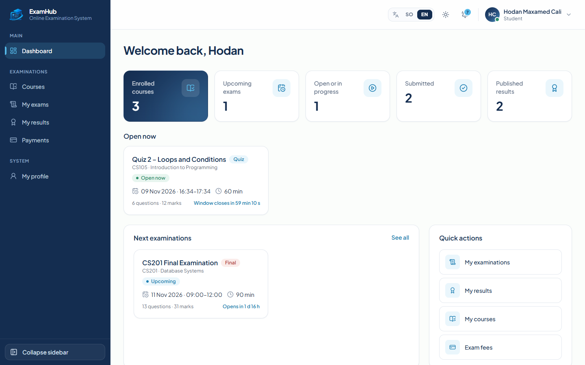

**Examination interface:** server-synchronised timer, automatic saving of every answer, question navigator and flags for review.

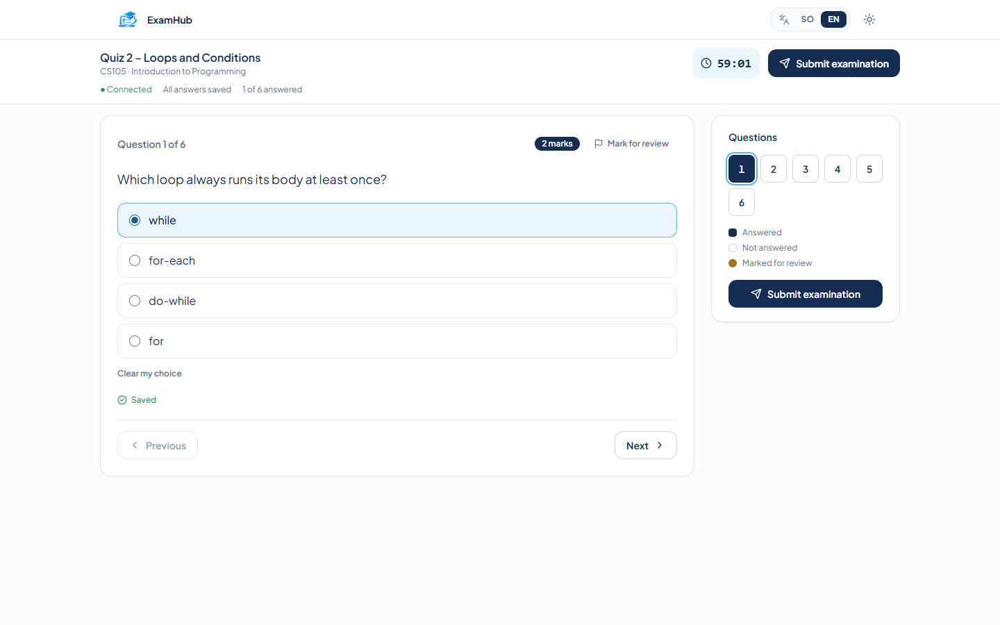

**Payments:** the semester fee, what has been paid and what is left, the rules per exam type and the payment history with receipts (simulated payments).

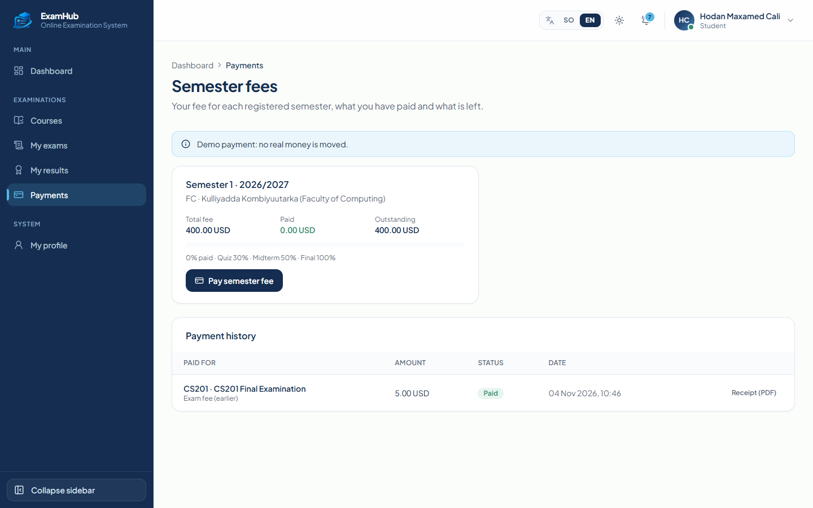

### Invigilator

**Dashboard:** assigned sessions, students taking an examination now and who needs attention.

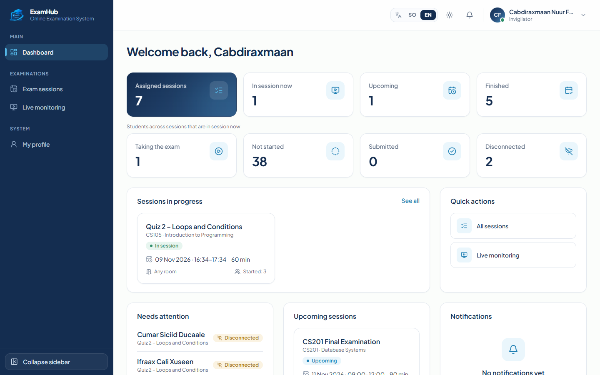

**Live monitoring:** every student of a session with status, time left, answers and tab switches, refreshed every 5 seconds.

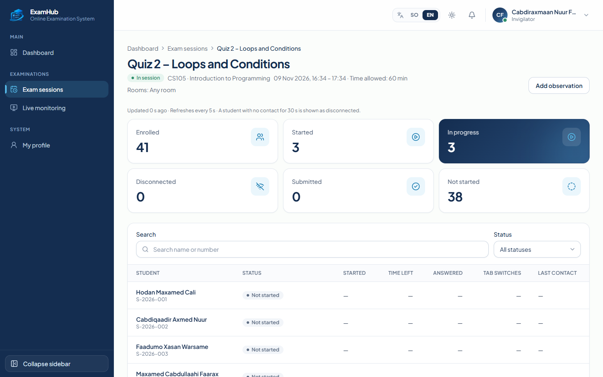

## Architecture

```
 Browser (Next.js 16, frontend/)
        │  HTTPS / JSON, HTTP-only session cookie
        ▼
 Express API  backend/src
   routes        modules/*/*.routes.ts     validation (zod), role checks, HTTP shape
   services      modules/*/*.service.ts,   business rules, ownership checks, transactions
                 services/*.ts
   repositories  repositories/*.ts         the only code that queries the database (Prisma)
   adapters      adapters/mobile-money.ts, simulated payment and SMS providers
                 adapters/sms-gateway.ts
   db            db/prisma.ts, db/clock.ts Prisma Client, transactions, clock sync, health check
   jobs        jobs/scheduler.ts         auto-submit at the deadline, payment expiry, SMS status
        │  restricted role exam_app (no owner rights), TLS for Supabase
        ▼
 PostgreSQL 17: campus server (primary) or Supabase (hosted copy)
   42 tables, CHECK constraints, triggers and row-level security as a second line of defence
```

**Layers**
- Screens never touch the database. Routes call services, and services call repositories. Only `src/repositories` and `src/db` use Prisma.
- A service decides where a transaction starts and passes the transaction handle on to the repositories. That way, multi-step changes succeed or fail together.
- `tests/unit/architecture.test.ts` fails if any other file uses Prisma.
- Important rules are enforced twice: by the service and by the database. For example:
  - the answer deadline is also checked by a trigger;
  - used question versions are locked by a trigger;
  - payment status changes are checked by a trigger;
  - result history is append-only.

**Main modules**

| Module | Path |
|---|---|
| auth | `src/modules/auth` |
| users | `src/modules/users` |
| courses | `src/modules/courses` |
| imports | `src/modules/imports` |
| questions | `src/modules/questions` |
| exams and schedules | `src/modules/exams`, `src/modules/schedules` |
| attempts | `src/modules/attempts` |
| invigilation | `src/modules/invigilation` |
| grading | `src/modules/grading` |
| results | `src/modules/results` |
| payments | `src/modules/payments` |
| messages | `src/modules/messages` |
| analytics | `src/modules/analytics` |
| academic structure | `src/modules/academic` |
| semester fees and eligibility | `src/modules/fees`, `src/services/eligibility.ts` |
| SMS Management | `src/modules/sms` |
| rooms | `src/modules/rooms` |
| grading scale | `src/modules/grading-scale` |

**Core technical challenge**

| Condition | How it is met | Code |
|---|---|---|
| Different sets, equal difficulty | Each rule fixes the type, difficulty and marks. The least-used questions are drawn first, and the order and options are shuffled per student. | `src/services/exam-generator.ts` |
| Late answers rejected | The deadline is set once on the server: min(start + duration, window end) + extensions. Saves are checked by the service and by a database trigger that uses the database clock. | `src/modules/attempts`, `src/services/submission.ts` |
| Resume after a reload | One attempt per student and exam. Reloading returns the frozen question set, the saved answers and the remaining time from the server deadline. | `src/modules/attempts` |

## Technology

| Part | Technology |
|---|---|
| Runtime | Node.js 24 (20 or newer works) |
| API | Express 5.3.0, TypeScript 5.9.3, Zod 4.6.7 |
| Database | PostgreSQL 17 (15+), Prisma ORM 7.10.1 with `@prisma/adapter-pg` |
| Security | bcryptjs 3.0.3 (cost 12), jsonwebtoken 9.0.3 (HTTP-only cookie), helmet 8.3.0, express-rate-limit 8.7.3 |
| Files | csv-parse 7.0.3 (imports), PDFKit 0.20.2 (receipts, result slips), multer 2.5.0 (uploads) |
| Tests | Vitest 4.1.12, supertest 7.3.1, embedded-postgres 17 (throwaway test database) |
| Frontend | Next.js 16.4.5 (App Router), React 19.3, TypeScript, Tailwind CSS 4.3, Radix UI, Recharts 3.10, Lucide icons |

## Install on a fresh computer

You need **Node.js 20 or newer** and **Git**. Docker and a PostgreSQL installation are not needed to run the tests.

```bash
git clone https://github.com/Nafiisamohamed/online-exam-platform.git
cd online-exam-platform/backend
npm install            # also generates the Prisma Client
npm test               # 301 tests on a throwaway PostgreSQL 17, started automatically
```

## Database setup

1. Copy `backend/.env.example` to `backend/.env`. Never commit `.env`.
2. Point `MIGRATE_DATABASE_URL` at the database owner. Use one of:
   - a campus or local PostgreSQL 17;
   - the Supabase Session Pooler. `npm run db:supabase-login` asks for the password and encodes it for you.
3. Run, from `backend/`:

```bash
npm run db:migrate        # prisma migrate deploy: applies the 9 migrations
npm run db:app-password   # enables the restricted exam_app login and writes DATABASE_URL
npm run db:seed:demo      # optional demo data: Somali names, real cities, USD fees
npm run db:seed:demo:analytics  # optional: 30 more students and a 38-student exam for analytics (loaded on Supabase)
npm run db:check          # read-only health check: every line must say PASS
```

Then set the API settings in `.env`:
- `JWT_SECRET` (at least 32 random characters);
- `DEMO_PAYMENT_PIN`;
- `CORS_ORIGIN`.

`.env.example` lists every setting with placeholders only.

More on the database:
- [docs/database.md](docs/database.md): the tables, rules, triggers and access security.
- [docs/database-environments.md](docs/database-environments.md): campus PostgreSQL vs Supabase, credentials, backups.

### Database diagram (main relationships)

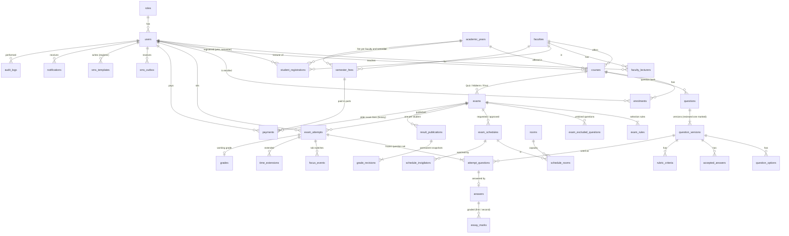

The full list of 42 tables is in [docs/database.md](docs/database.md#tables-42).

## Run the API

```bash
cd backend
npm run dev                  # development: reloads on change, http://localhost:4000/api
npm run build && npm start   # production build
```

**Check it's running:** `GET http://localhost:4000/api/health` answers `{ "status": "ok", "database": "ok", "serverTime": "…" }`.

**Background jobs:** the server runs them every 5 seconds:
- automatic submission at the deadline;
- payment expiry;
- SMS status updates.

## Run the frontend

```bash
cd frontend
npm install
npm run dev                  # http://localhost:3000
npm run build && npm start   # production build
```

- The browser talks only to the Next.js server. Requests to `/api/*` are forwarded to the API at `BACKEND_URL` (default `http://localhost:4000`), so the session cookie stays on one origin.
- **If port 4000 is already used by another program**, run the API on another port for that session and point the frontend at it, without editing either config file:
  ```bash
  cd backend  && PORT=4100 npm run dev
  cd frontend && BACKEND_URL=http://localhost:4100 npm run dev   # or: npm run build && npm start
  ```
  For `npm run build`, `BACKEND_URL` must be set when building: Next.js fixes the forwarding address at build time. Check with `curl http://localhost:3000/api/health`; it should return `{"status":"ok","database":"ok",…}`.
- Sign in at `/sign-in` (student number or staff email). Accounts with a temporary password must choose a new one before anything else opens. Signing out ends the browser session; a session that the server ends (deactivated account, changed password) returns the user to the sign-in page with a message: at the next request, at the latest within 30 seconds on an idle page, and at once when the user comes back to the tab. The profile page changes the password (current, new, repeat; the server's rule: 8+ characters with a letter and a digit) and the language used for SMS and notifications.
- The registrar pages are under `/admin/*`, the lecturer pages under `/lecturer/*` the student pages under `/student/*` and the invigilator pages under `/invigilator/*`; each role's overview is at `/dashboard`. A running exam opens at `/exam/<attemptId>`, outside the menus. They show live API data only. When nobody is signed in they ask the user to sign in, and they never show sample numbers.
- **The exam screen follows the server.** The timer counts down from the server's remaining time (re-synced by a heartbeat every 5 seconds, so invigilator extensions appear at once; changing the device clock has no effect). Each answer shows "Saved" only after the server accepted it; failed saves are retried and the page warns before leaving with unsaved answers. A refresh returns the same attempt with the saved answers. Leaving the page is reported to the server, which counts losses of 1 second or more, warns at the 1st and 2nd, and ends the examination at the 3rd (saved answers are kept for the lecturer).
- Lecturers build exams from **question rules** (N questions of a type, difficulty and mark value, optionally from topics). Each student gets their own random draw, as the backend's exam generator works; questions are not hand-picked. A schedule request goes to the registrar for approval.
- Without a session no page opens: every route redirects to `/sign-in` (there is no preview mode and no sample data).
- Frontend checks: `npm run lint`, `npm run typecheck`, `npm test`.

## Tests

```bash
cd backend
npm test            # everything: database, API and unit tests (301)
npm run test:api    # API only
npm run test:unit   # pure logic only
npm run verify:db   # non-destructive checks against an existing database, e.g. Supabase
```

- **Where the tests run:** against a fresh, throwaway PostgreSQL 17 (or your own test database), never against Supabase or development data.
- **Coverage:** the three completion conditions, permissions, payments, grading, publication history and more.
- **CI:** [`.github/workflows/ci.yml`](.github/workflows/ci.yml) runs the type check, the tests and the build on every push, for the backend and for the frontend (which also runs lint).
- **Details:** [docs/testing.md](docs/testing.md).

## API reference

Every endpoint, with method, path, roles, request, response and error codes: **[docs/api.md](docs/api.md)**.

## Demo accounts

`npm run db:seed:demo` creates fictional accounts for every role (Somali names, `.test` email addresses that can never receive mail):

Everyone signs in with their **username** (an automatic account number); staff can also use their email address.

| Role | Username | Email |
|---|---|---|
| Admin / Registrar | `R-2026-001` | `registrar@uni-demo.test` |
| Lecturer | `T-2026-001`, `T-2026-002`, `T-2026-003` | `axmed.samatar@uni-demo.test`, `khadra.cilmi@uni-demo.test`, `mustafe.jibriil@uni-demo.test` |
| Invigilator | `I-2026-001`, `I-2026-002` | `cabdiraxmaan.faarax@uni-demo.test`, `deeqa.aadan@uni-demo.test` |
| Student | `S-2026-001` … `S-2026-010` | – |

**Account numbers.** The server gives every new account the next number of its role and year: `S-YYYY-NNN` (student), `T-` (lecturer), `R-` (registrar), `I-` (invigilator), with YYYY the current year in Mogadishu. After `S-2026-005` comes `S-2026-006`; after `-999` comes `-1000`. Numbers are never typed, also not in the CSV student import (leave `student_id` empty for new students). They come from one counter per role and year in the database, taken inside the transaction that creates the account, so two accounts created at the same moment never share a number. Accounts that existed before numbering kept their identity, password and history; their old student number (e.g. `DEMO-2026-0007`) is kept as `legacy_number`.

**Passwords**
- Each account gets a random password, stored only as a bcrypt hash.
- The plain passwords are written once, to `backend/demo-accounts.local.md` on the machine that ran the seed. Git ignores that file.
- They are not published here, because the hosted demo database is reachable from the internet.
- Judges receive them privately. On demo day, `npm run demo:judge-credentials` issues fresh passwords for one account per role (plus a second lecturer and a second student) and writes them to a private, git-ignored sheet. Running it again after judging changes them, so the judges' passwords stop working. See [docs/demo-data.md](docs/demo-data.md#giving-the-judges-access).

**Simulated payments:** the demo PIN is the `DEMO_PAYMENT_PIN` setting (`1234` in `.env.example`). It is not a real PIN.

See [docs/demo-data.md](docs/demo-data.md) for the full dataset.

## Security

| Area | How it is handled |
|---|---|
| Passwords | bcrypt (cost 12). Temporary passwords must be changed at first login and expire after 7 days. |
| Sessions | JWT in an HTTP-only, SameSite=Strict cookie. Signing out ends the session on the server (the token stops working at once). A password change or deactivation ends all sessions. |
| Permissions | The role and record ownership are checked on the server for every request. Other people's records return 404. |
| Input | Validated with zod. Uploads are size-limited and type-checked. CSV exports are protected against spreadsheet formulas. |
| Rate limits | On the API, the login and the demo PIN |
| Audit log | Sensitive actions are logged (append-only). Secrets are removed from log details. |
| Database role | The API connects as `exam_app`: not the owner, no RLS bypass, can't disable triggers or alter tables |
| Simulated services | Payments and SMS can only run simulated: the server refuses to start otherwise, every SMS starts with `[DEMO]` and receipts say "Simulated payment – no money was transferred." |
| Secrets | `.env` is ignored by git. `.env.example` contains placeholders only. |

## Known limitations

| Limitation | Notes |
|---|---|
| Simulated payments and SMS | There is no connection to EVC Plus, Zaad, eDahab, Hormuud or Somtel. Payments move no money; SMS statuses (queued, sent, delivered, failed) are produced by a simulator. |
| No real fees configured | Semester fees start empty: the registrar enters the amounts the university decides. Until a fee is set, students are not blocked from exams and the registrars get a notification. |
| Older courses and exams | Courses created before academic years existed have no year or semester, so fee eligibility does not apply to them. The 9 exams from before exam types were added keep the types the owner approved. |
| Tab-switch termination | The brief (4.8) asks for a warning after 3 switches and leaves the penalty to the lecturer. This project terminates the attempt at the 3rd counted switch instead (on request). It is one constant, `MAX_COUNTED_FOCUS_LOSSES` in `backend/src/modules/attempts/attempts.service.ts`. |
| No network restriction | Students can take examinations from any device and connection; rooms are for scheduling and capacity only. The client address is recorded on each attempt and in Activity History; behind a reverse proxy, set `TRUST_PROXY=true`. |
| Live views poll | The invigilator live list and notifications refresh every few seconds; there is no push channel. |
| Profile | Users can change only their password and the language of SMS and notifications; there is no photo upload. |
| Somali texts | The Somali translations should be reviewed by a native speaker. |
| Short-answer matching | It ignores only case and extra spaces, as the brief says. Punctuation differences go to "Needs review". |
| Clock offset | The browser shows the time remaining from the server's timer. Network delay of a few hundred milliseconds isn't compensated, so last-chance warnings appear slightly early. |
| Backup and restore | Backups are taken with `pg_dump` 17 and were restored and compared table by table before every database change. The procedure is in [docs/backup-restore.md](docs/backup-restore.md). |
| Not built | Real payment and SMS gateways, webcam proctoring and plagiarism checking are out of scope, as the brief says. |
